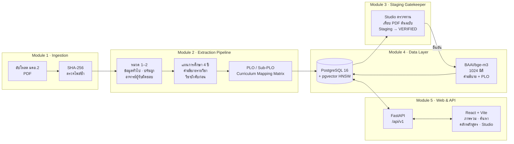

# Curriculum Database — ระบบสกัดและจัดการฐานข้อมูลหลักสูตรอัจฉริยะจากเอกสาร มคอ.2

โครงงานวิศวกรรมคอมพิวเตอร์ มหาวิทยาลัยกาฬสินธุ์

ระบบรับเอกสาร **มคอ.2 (TQF2) เป็นไฟล์ PDF** แล้วสกัดข้อมูลออกมาเป็นฐานข้อมูลที่มีโครงสร้าง ได้แก่
- ข้อมูลทั่วไปของหลักสูตร ปรัชญา วัตถุประสงค์ และอาจารย์ผู้รับผิดชอบ
- รายวิชาพร้อมคำอธิบาย และวิชาบังคับก่อน
- ผลลัพธ์การเรียนรู้ (PLO)
- เมทริกซ์ Curriculum Mapping

เมื่อสกัดแล้ว ผู้ใช้ตรวจทานเทียบกับต้นฉบับใน **ห้องตรวจทาน (Studio)** ก่อนยืนยัน จากนั้นระบบจึงสร้างเวกเตอร์ด้วย **BAAI/bge-m3** สำหรับ**ค้นหารายวิชาเชิงความหมาย** และส่งออกเป็น JSON แบบต้นไม้ (AI-Ready)

## ภาพรวมระบบ



| Module | หน้าที่ | ไฟล์หลัก |
|---|---|---|
| 1 | รับไฟล์ PDF และตรวจไฟล์ซ้ำด้วย SHA-256 ถ้าเอกสารเดิมมีข้อมูลครบแล้วจะไม่ประมวลผลซ้ำ | `backend/main.py`, `backend/pipeline.py` |
| 2 | อ่าน PDF ด้วย pdfplumber และปรับข้อความไทยที่เพี้ยนจาก PDF ให้ถูกต้อง จากนั้นสกัดหมวด 1–2, แผนการศึกษา, คำอธิบายรายวิชา, วิชาบังคับก่อน, PLO และตาราง Mapping ข้ามหลายหน้า | `backend/pipeline.py`, `backend/extractor.py` |
| 3 | Staging Gatekeeper: ข้อมูลใหม่อยู่ในสถานะรอตรวจ (Staging) ผู้ใช้ตรวจและแก้ไขใน Studio แล้วกดยืนยันเป็น `VERIFIED` ระบบค้นหาใช้เฉพาะหลักสูตรที่ยืนยันแล้ว | `frontend/src/pages/studio/` |
| 4 | ตารางหลักสูตร รายวิชา PLO วิชาบังคับก่อน และ Mapping พร้อมเวกเตอร์ 1024 มิติ (ดัชนี HNSW) | `init.sql`, `backend/pipeline.py` |
| 5 | REST API และเว็บ: ภาพรวม, ค้นหาด้วย AI, คลังหลักสูตร, ห้องตรวจทาน และส่งออก JSON | `backend/main.py`, `backend/search_utils.py`, `frontend/` |

## โครงสร้าง repo

```
backend/
  main.py                     FastAPI — API ทั้งหมด + งานประมวลผลเบื้องหลัง
  pipeline.py                 Pipeline สกัด มคอ.2 ครบทุกหมวด (pdfplumber)
  extractor.py                Pydantic schema + ตัวช่วยแยกหน่วยกิต/ตรวจข้อความ
  search_utils.py             Hybrid Search: รวมคะแนน vector + keyword
  export_json.py              ส่งออกเป็น Tree-structured JSON (AI-Ready)
  generate_embeddings.py      สร้างเวกเตอร์รายวิชาใหม่ทั้งหมด
  generate_plo_embeddings.py  สร้างเวกเตอร์ PLO
  extract_*.py, update_*.py   สคริปต์สกัดทีละส่วน (ใช้ทดสอบ/แก้ไขเฉพาะจุด)
  check_data.py, clear_db.py  ตรวจสรุปข้อมูล / ล้างข้อมูล (ตารางยังอยู่)
  uploads/                    ไฟล์ PDF ที่อัปโหลด (ไม่ขึ้น Git)
frontend/                     React 19 + Vite + Tailwind CSS 4
init.sql                      สร้างตาราง ดัชนี pgvector อัตโนมัติ
docker-compose.yml            PostgreSQL 16 + pgvector
```

## โครงสร้างฐานข้อมูล

| ตาราง | เก็บอะไร |
|---|---|
| `curriculums` | ข้อมูลหลักสูตร ปรัชญา วัตถุประสงค์ อาจารย์ผู้รับผิดชอบ (JSONB) ข้อมูลดิบ (`raw_json`) สถานะการยืนยัน และ SHA-256 |
| `courses` | รหัสวิชา ชื่อไทย/อังกฤษ หน่วยกิต หมวดวิชา ภาคที่เรียน คำอธิบาย และ `embedding vector(1024)` |
| `plos` | PLO และ Sub-PLO พร้อม `embedding vector(1024)` |
| `course_prerequisites` | คู่วิชาและวิชาบังคับก่อน |
| `curriculum_mappings` | เมทริกซ์ความสัมพันธ์รายวิชา–PLO |

## ติดตั้ง

ต้องมี **Docker Desktop**, **Python 3.10+** และ **Node.js 20+**

> ครั้งแรกที่รัน backend ระบบจะดาวน์โหลดโมเดล **BAAI/bge-m3** (ประมาณ 2 GB) ใช้เวลาสักครู่ ถ้ามีการ์ดจอ NVIDIA ให้ติดตั้ง PyTorch แบบ CUDA ตาม [pytorch.org](https://pytorch.org) จะสร้างเวกเตอร์ได้เร็วขึ้น

1. **ฐานข้อมูล** (ครั้งแรกระบบรัน `init.sql` สร้างตารางให้อัตโนมัติ)
   ```bash
   git clone https://github.com/arthityak464-png/curriculum-database.git
   cd curriculum-database
   docker compose up -d
   ```
2. **Backend**
   ```bash
   cd backend
   python -m venv venv
   venv\Scripts\activate          # macOS/Linux: source venv/bin/activate
   pip install -r requirements.txt
   uvicorn main:app --reload
   ```
   API docs (Swagger) อยู่ที่ http://localhost:8000/docs
3. **Frontend** (หน้าต่างใหม่) แล้วเปิด http://localhost:5173 (Vite ส่งต่อ `/api` ไปพอร์ต 8000 ให้)
   ```bash
   cd frontend
   npm install
   npm run dev
   ```

### ค่าตั้งค่า (ไม่บังคับ — มีค่าเริ่มต้นแล้ว)

| ตัวแปร | ค่าเริ่มต้น | ความหมาย |
|---|---|---|
| `POSTGRES_HOST` / `POSTGRES_PORT` | `localhost` / `5432` | ที่อยู่ฐานข้อมูล |
| `POSTGRES_DB` / `POSTGRES_USER` / `POSTGRES_PASSWORD` | `postgres` / `postgres` / `1234` | ต้องตรงกับ `docker-compose.yml` |
| `EMBEDDING_MODEL` | `BAAI/bge-m3` | โมเดลสร้างเวกเตอร์ |
| `SEARCH_MIN_SIMILARITY` | `0.45` | ค่า cosine similarity ขั้นต่ำของผลค้นหา |

> รหัสผ่านเริ่มต้นใช้สำหรับพัฒนาบนเครื่องตัวเองเท่านั้น ถ้าจะเปิดให้ผู้อื่นเข้าถึง ให้เปลี่ยนรหัสผ่านทั้งใน `docker-compose.yml` และตัวแปร `POSTGRES_PASSWORD`

## ใช้งาน

| หน้า | ทำอะไร |
|---|---|
| ภาพรวม | สรุปจำนวนเอกสารหลักสูตร ที่รอตรวจทาน และที่อนุมัติแล้ว พร้อมคิวหลักสูตร อัปโหลด มคอ.2 แล้วติดตามความคืบหน้าของ Pipeline ทีละขั้น และค้นหาด่วน |
| ห้องตรวจทาน (Studio) | เปิด PDF ต้นฉบับคู่กับข้อมูลที่สกัดได้ แก้ไขข้อมูลทั่วไปและรายวิชา แล้วกด **ยืนยัน** เพื่อเปลี่ยนเป็น `VERIFIED` และสร้างเวกเตอร์ |
| คลังหลักสูตร | ดูสรุปหลักสูตร รายวิชาแยกตามหมวด รายละเอียดวิชา อาจารย์ผู้รับผิดชอบ และเมทริกซ์ PLO |
| ค้นหาด้วย AI | พิมพ์ทักษะหรือหัวข้อเป็นภาษาไทยหรืออังกฤษ ระบบค้นแบบ Hybrid (เวกเตอร์ + คำค้นตรงตัว) ไฮไลต์คำที่ตรงกัน และกดไปดูวิชาในคลังหลักสูตรได้ (API กรองตามหลักสูตรหรือหมวดวิชาได้ด้วย `curriculum_id`, `course_group`) |

**ลำดับสถานะ:** อัปโหลด → `UNVERIFIED` / Staging (สกัดเสร็จ รอตรวจ) → ตรวจใน Studio → `VERIFIED` (ค้นหาและส่งออกได้)

### API หลัก

| Method | Endpoint | หน้าที่ |
|---|---|---|
| `POST` | `/api/v1/curriculums/upload` | อัปโหลด PDF และเริ่ม Pipeline (คืน `job_id`) |
| `GET` | `/api/v1/jobs/{job_id}` | ดูความคืบหน้าของงาน |
| `GET` | `/api/v1/curriculums` · `/{id}` | รายการ / รายละเอียดหลักสูตร |
| `PUT` | `/api/v1/curriculums/{id}` | แก้ไขข้อมูลหลักสูตร |
| `POST` | `/api/v1/curriculums/{id}/commit` | ยืนยันหลักสูตร (`VERIFIED`) และสร้างเวกเตอร์ |
| `GET` | `/api/v1/courses/search?query=...` | ค้นหารายวิชาเชิงความหมาย |
| `GET` | `/api/v1/curriculums/{id}/plos` · `/mapping` | PLO และเมทริกซ์ Mapping |
| `GET` | `/api/v1/curriculums/{id}/export/json` | ส่งออก JSON แบบต้นไม้ |

## สคริปต์ช่วยเหลือ (รันในโฟลเดอร์ `backend`)

```bash
python test_connection.py        # ทดสอบการเชื่อมต่อฐานข้อมูล
python check_data.py             # สรุปข้อมูลที่สกัดได้ล่าสุด
python export_json.py            # ส่งออก JSON แบบต้นไม้
python generate_embeddings.py    # สร้างเวกเตอร์รายวิชาใหม่ทั้งหมด
python test_search.py            # ทดลองค้นหาเชิงความหมายจากบรรทัดคำสั่ง
python clear_db.py               # ล้างข้อมูลทั้งหมด (ตารางยังอยู่) — ระวัง
```

## ขอบเขตและข้อจำกัด

- ออกแบบและทดสอบกับรูปแบบเอกสาร มคอ.2 ของมหาวิทยาลัยกาฬสินธุ์ ถ้าเอกสารจากสถาบันอื่นมีหัวข้อหรือรูปแบบตารางต่างกัน อาจต้องปรับกฎการสกัด
- รองรับ PDF ที่มีข้อความ (text layer) ส่วนไฟล์สแกนที่เป็นภาพล้วนต้องทำ OCR ก่อน
- การสร้างเวกเตอร์ทำงานบนเครื่อง (ไม่ใช้ API ภายนอก) จึงไม่มีค่าใช้จ่าย แต่ถ้าไม่มี GPU จะช้ากว่า
- ระบบยังไม่มีการยืนยันตัวตนผู้ใช้ ควรใช้ภายในเครือข่ายเท่านั้น

## เทคโนโลยี

FastAPI · psycopg2 · Pydantic · pdfplumber · sentence-transformers (BAAI/bge-m3) · PyTorch · PostgreSQL 16 + pgvector · React 19 · Vite · Tailwind CSS 4 · Docker Compose
